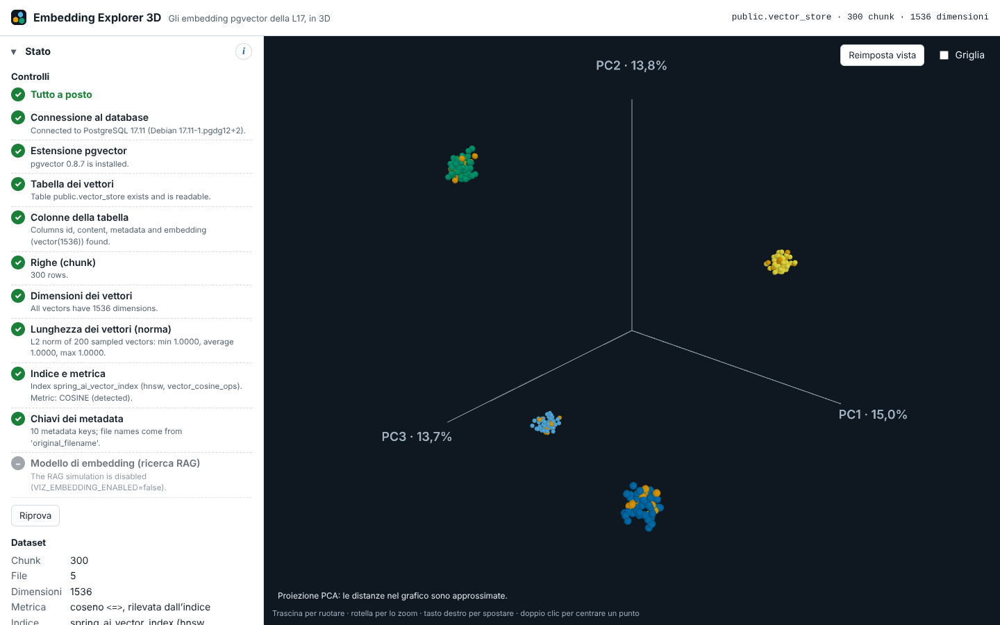

# Embedding Explorer 3D

Uno strumento didattico per il corso **"Full Stack Web Developer con Java e React"**: mostra in 3D
gli embedding che il chatbot della **L17** ha salvato in PostgreSQL con pgvector.
Ogni punto è un **chunk** di un PDF; puoi selezionarlo, leggerne il testo e i 1536 numeri del suo
embedding, vedere i suoi vicini veri e simulare una ricerca RAG come fa il `RagService` della L18.



> Lo screenshot mostra il database demo (dati sintetici). Puoi sostituire `docs/img/screenshot.png` con
> uno screenshot dei PDF della tua classe.

## Cosa fa (e cosa non fa)

**Fa:**

- si collega **in sola lettura** al database della L17 e controlla, passo per passo, che tutto sia a
  posto (sezione **Stato**);
- disegna tutti i chunk come una nuvola di punti 3D, colorati per file, pagina o qualunque chiave
  dei metadata;
- mostra il chunk selezionato: testo, metadata, statistiche del vettore e il suo "codice a barre";
- trova i **vicini veri** di un chunk e confronta due chunk, con i calcoli fatti dal database;
- simula la ricerca RAG: la domanda diventa un embedding e vedi quali chunk entrano nel contesto e
  quali vengono scartati dalla soglia.

**Non fa (di proposito):**

- **non disegna i 1536 numeri**: nessuno può. Le posizioni 3D sono una **proiezione** (PCA), cioè
  l'"ombra" dei punti sulle tre direzioni in cui differiscono di più. È utile, ma alcune distanze si
  schiacciano: la sezione **Proiezione** dice quanta informazione resta visibile;
- **non calcola mai distanze sul grafico**: similarità, distanze e vicini sono sempre calcolati dal
  database (o dal backend) sui **vettori completi**;
- non scrive nel database, non carica PDF (lo fa il chatbot), non ha login né utenti.

## Avvio rapido

Servono Docker e Docker Compose. Tutti i comandi si lanciano dalla cartella del progetto.

### A) Con il database della L17

1. Avvia il database della L17 (nella cartella `docker` del progetto L17):

   ```bash
   docker compose up -d
   ```

2. Crea il file di configurazione a partire dall'esempio (contiene le credenziali di classe della L17):

   ```bash
   cp .env.example .env
   ```

3. Costruisci e avvia lo strumento:

   ```bash
   docker compose up --build -d
   ```

4. Apri <http://localhost:8088>. Al primo avvio una breve guida indica le tre cose da provare.

Il backend raggiunge il database della L17 attraverso la porta pubblicata sull'host
(`host.docker.internal:5432`). Se non funziona, o vuoi altre configurazioni, leggi
[Collegare lo strumento al database vettoriale](docs/collegamento-database-vettoriale.md).

### B) Con il database demo (dati sintetici)

Non serve la L17: un database demo contiene dati **sintetici** (lo dicono il testo dei chunk e il
metadata `"demo": true`).

```bash
docker compose -f docker-compose.yml -f compose.demo.yaml up --build -d
```

Il database demo ha due tabelle:

| Tabella | Contenuto |
| --- | --- |
| `public.vector_store` | 300 chunk sintetici, 1536 dimensioni, 5 file (4 temi più un file di FAQ misto) |
| `public.vector_store_minilm` | gli stessi chunk con vettori di 384 dimensioni, come una tabella della L18 §12 |

Per passare alla seconda tabella imposta `VIZ_DB_TABLE=vector_store_minilm` nel file `.env` e
rilancia lo stesso comando.

### Verifica automatica

Dopo l'avvio, questo script controlla la salute del backend, la diagnostica e i punti passando da
nginx, e stampa un riepilogo leggibile:

```bash
./scripts/smoke-test.sh
```

Per fermare tutto: `docker compose down` (con la demo aggiungi gli stessi `-f`). **Non** usare mai
`-v` sul progetto della L17: cancelleresti i suoi dati.

## L'interfaccia

A sinistra la barra laterale, a destra la vista 3D (trascina per ruotare, rotella per lo zoom,
tasto destro per spostare, doppio clic per centrare un punto). Le sezioni, in ordine:

1. **Stato**: la checklist di diagnostica e il riepilogo del dataset.
2. **Come leggere il grafico**: la guida di un minuto.
3. **Proiezione**: metodo, varianza spiegata da PC1, PC2, PC3, normalizzazione, dimensione dei punti.
4. **Colori e filtri**: "Colora per", legenda, filtri per file e pagine, ricerca nel testo e la lista
   dei chunk (l'alternativa accessibile al grafico).
5. **Chunk selezionato**: testo, metadata, vettore e vicini veri.
6. **Confronta due chunk**: similarità vera accanto alla distanza nel grafico.
7. **Simula una ricerca RAG**: domanda, `topK`, `similarityThreshold` e la query SQL di Spring AI.
8. **Esercizi**: attività da fare in classe (vedi la [guida didattica](docs/guida-didattica.md)).

Ogni sezione ha un pulsante **i** con una spiegazione breve e la lezione di riferimento.

## Configurazione

Tutte le impostazioni sono variabili d'ambiente nel file `.env` (vedi `.env.example`). Il backend
le controlla all'avvio: un valore non valido (per esempio un nome di tabella con caratteri strani)
blocca l'avvio con un messaggio chiaro.

| Variabile | Default | Note |
| --- | --- | --- |
| `VIZ_DB_URL` | `jdbc:postgresql://host.docker.internal:5432/chatbot` | URL JDBC del database della L17 |
| `VIZ_DB_USER` | `chatbot` | meglio un utente di sola lettura, vedi la guida al collegamento |
| `VIZ_DB_PASSWORD` | nessuno | solo dal file `.env`, mai nel codice |
| `VIZ_DB_SCHEMA` | `public` | identificatore minuscolo (lettere, cifre, `_`) |
| `VIZ_DB_TABLE` | `vector_store` | per la L18: `vector_store_bge_m3`, `vector_store_minilm` |
| `VIZ_DB_STATEMENT_TIMEOUT` | `15s` | durata massima di ogni query |
| `VIZ_DB_CONNECTION_TIMEOUT` | `5s` | attesa massima di una connessione (database spento = errore rapido) |
| `VIZ_DISTANCE_METRIC` | `auto` | `auto`, `cosine`, `l2` o `inner_product`; `auto` la legge dall'indice |
| `VIZ_MAX_POINTS` | `5000` | oltre questo numero di chunk il grafico mostra un campione fisso |
| `VIZ_SNAPSHOT_MEMORY_BUDGET_MB` | `256` | memoria massima per i vettori caricati |
| `VIZ_EMBEDDING_ENABLED` | `false` | attiva "Simula una ricerca RAG" |
| `VIZ_EMBEDDING_BASE_URL` | `https://api.openai.com/v1` | Ollama: `http://host.docker.internal:11434/v1`; Docker Model Runner: `http://model-runner.docker.internal/engines/v1` |
| `VIZ_EMBEDDING_MODEL` | `text-embedding-3-small` | deve essere **lo stesso modello** usato per indicizzare la tabella |
| `VIZ_EMBEDDING_API_KEY` | vuoto | solo per OpenAI; resta nel backend, non arriva mai al browser |
| `VIZ_SEARCH_RATE_LIMIT_PER_MINUTE` | `10` | chiamate al modello di embedding al minuto (ricerche e prove) |
| `VIZ_BIND_ADDRESS` | `127.0.0.1` | indirizzo su cui è pubblicato il frontend, vedi l'avviso sotto |
| `VIZ_HTTP_PORT` | `8088` | porta del frontend sull'host |
| `VIZ_L17_NETWORK` | `docker_default` | solo per l'opzione B della guida al collegamento |

> **Attenzione a `VIZ_BIND_ADDRESS=0.0.0.0`.** Con il valore predefinito lo strumento è visibile solo
> dal tuo computer. Con `0.0.0.0` chiunque sia sulla tua rete può aprirlo e **leggere i tuoi
> documenti** (il testo dei chunk). Usalo solo in aula, su una rete fidata, e solo se serve.

Dopo aver cambiato il file `.env`, applica le modifiche con `docker compose up -d`.

## Attivare "Simula una ricerca RAG"

La simulazione trasforma la domanda in un embedding, quindi serve un modello. Regola d'oro
(L18 §12.1): **la domanda va trasformata con lo stesso modello usato per indicizzare la tabella**.
Lo strumento controlla le dimensioni del vettore: se non coincidono risponde `DIMENSION_MISMATCH`.

- **OpenAI** (la tabella della L17 usa `text-embedding-3-small`, 1536 dimensioni):

  ```bash
  VIZ_EMBEDDING_ENABLED=true
  VIZ_EMBEDDING_API_KEY=sk-la-tua-chiave
  ```

- **Ollama** (per una tabella indicizzata con `bge-m3`, 1024 dimensioni, come nella L18 §12):

  ```bash
  VIZ_EMBEDDING_ENABLED=true
  VIZ_EMBEDDING_BASE_URL=http://host.docker.internal:11434/v1
  VIZ_EMBEDDING_MODEL=bge-m3
  VIZ_DB_TABLE=vector_store_bge_m3
  ```

Nella sezione **Stato** il pulsante **Prova il modello** fa una chiamata vera e mostra modello,
dimensioni e tempo di risposta. Ogni ricerca ha un piccolo costo con OpenAI: per questo c'è un limite
di chiamate al minuto.

## Sviluppo senza Docker (opzione C)

Requisiti: Java 21, Node 22.12+ (o Node 24) e Docker solo per i test di integrazione.

Backend, con il database della L17 sulla porta 5432:

```bash
cd backend
VIZ_DB_URL=jdbc:postgresql://localhost:5432/chatbot VIZ_DB_PASSWORD=chatbot123 ./mvnw spring-boot:run
```

Frontend, in un altro terminale:

```bash
cd frontend
npm ci
npm run dev
```

Apri <http://localhost:5173>: Vite inoltra le chiamate `/api` al backend su `localhost:8080`.
Usa `npm ci` e non `npm install`: con Node 22 (npm 10) `npm install` può fallire per un bug di npm
(vedi la decisione D16 in [docs/decisions.md](docs/decisions.md)).

## Test

```bash
cd backend
./mvnw verify
```

Esegue i test unitari e i test di integrazione con Testcontainers (serve Docker: le immagini
`pgvector/pgvector:0.8.7-pg17` e `postgres:17.11-alpine3.24` vengono scaricate da sole).

```bash
cd frontend
npm test
npm run typecheck
npm run lint
```

La build dell'immagine del frontend esegue anche il controllo dei tipi, il lint e i test: se uno
fallisce, l'immagine non viene creata.

## Sicurezza in breve

- **Sola lettura per costruzione**: connessione `readOnly` con `readOnlyMode=always`, timeout su ogni
  query, solo istruzioni `SELECT` con valori passati come parametri. Meglio ancora un utente
  dedicato di sola lettura (vedi la guida al collegamento).
- **Segreti solo nel file `.env`**, che non va mai committato (è in `.gitignore`); la chiave API non
  arriva mai al browser.
- Il frontend è pubblicato solo su `127.0.0.1` per default; il backend non è pubblicato.
- nginx imposta una Content-Security-Policy restrittiva; il testo dei PDF è mostrato sempre come
  testo semplice, mai come HTML.

## Problemi frequenti

| Cosa vedi | Cosa fare |
| --- | --- |
| "Il database vettoriale non risponde." (`DB_UNAVAILABLE`) | avvia il database della L17 e controlla `VIZ_DB_URL`; lo strumento si riprende da solo entro una decina di secondi |
| "Il database ha rifiutato utente o password." (`DB_AUTH_FAILED`) | controlla `VIZ_DB_USER` e `VIZ_DB_PASSWORD` nel file `.env` |
| "Nel database manca l'estensione pgvector." (`PGVECTOR_MISSING`) | usa l'immagine `pgvector/pgvector:pg17` |
| "La tabella dei vettori non esiste." (`TABLE_NOT_FOUND`) | avvia il chatbot almeno una volta, o controlla `VIZ_DB_TABLE` |
| "Il backend non risponde." (`BACKEND_UNAVAILABLE`) | il backend si sta avviando: aspetta qualche secondo, poi `docker compose logs viz-backend` |
| La pagina non si apre | controlla `docker compose ps` e la porta `VIZ_HTTP_PORT` |

La tabella completa, con ogni codice di errore, è in
[Collegare lo strumento al database vettoriale](docs/collegamento-database-vettoriale.md).

## Limiti noti

- La proiezione PCA è un'approssimazione: con gli embedding di testo le tre componenti mostrano di
  solito ben meno della metà della varianza. È normale, ed è proprio la lezione.
- Oltre `VIZ_MAX_POINTS` chunk il grafico mostra un **campione** deterministico (sempre lo stesso);
  lo dice la sezione **Stato**.
- La ricerca testuale cerca le parole nel testo completo dei chunk, senza ricerca semantica.
- I vicini veri sono calcolati con una ricerca **esatta** (scansione completa); il chatbot e la
  simulazione RAG usano invece l'indice HNSW, approssimato ma più veloce.
- Il limite di chiamate al minuto è in memoria: vale per una sola istanza del backend.

## Documentazione

- [Collegare lo strumento al database vettoriale](docs/collegamento-database-vettoriale.md)
- [Guida didattica e esercizi](docs/guida-didattica.md)
- [Architecture](docs/architecture.md) (in inglese)
- [Decisions](docs/decisions.md) (in inglese)
- [Piano di lavoro e checkpoint](PLAN.md)
